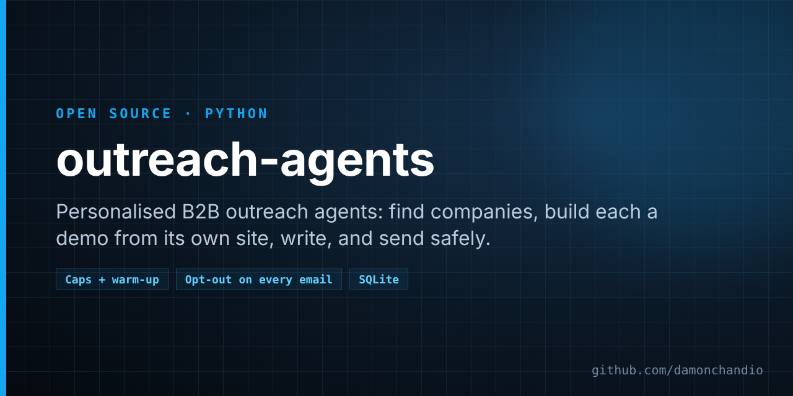

# outreach-agents



[](https://github.com/damonchandio/outreach-agents/actions/workflows/tests.yml)   [](https://github.com/damonchandio/outreach-agents/stargazers)

Five small agents that do personalised B2B outreach for a one-person agency, carefully.

Small agencies and freelancers can't write a thoughtful, specific email to hundreds of local businesses by hand, and the usual alternative (a scraped list and a mail merge) is spam. This project sits in between. It finds real UK limited companies, builds each one a working demo of a chat assistant trained on its own website, and sends one short, honest email with a link to that demo. It keeps volumes low, stops the moment anyone asks, and never emails someone it can't confirm is a company.

## How it works

```
 OpenStreetMap ──► Scout ──► Builder ──► Writer ──► Postman ──► their inbox
                    │          │           │          │
          Companies House   their own    an LLM     caps, windows,      Reader ◄── replies
          (is it a Ltd?)    website      (local     suppression list,     │
                                         or free)   stop rules            ▼
                                                                 opt-outs, bounces,
                                                                 hot leads to you
```

**Scout** lists local businesses with a website from OpenStreetMap, area by area, and checks each one properly:

- skips chains (the same website on several shops, or branch and store-locator pages) and businesses whose "website" is a Facebook page or a delivery platform
- reads a few pages of the site (robots.txt respected, identified as a bot) for a business email on the company's own domain and a company number
- skips sites that now redirect to a different company's domain (bought out or merged: your email would reach someone else's head office)
- skips businesses that already have a chat widget
- confirms an **active limited company or LLP** with the free Companies House API, either from the number on their site or an exact name and postcode match; anything less certain is rejected
- checks the address's domain has a mail server and that it isn't on the suppression list

Every result is kept, with the reason for any rejection, so nothing is checked twice.

**Builder** reads the business's site (up to 12 pages), writes a greeting and four sample questions using only what the site says, and keeps the text in small chunks. The demo page answers visitors' questions from the best-matching chunks, and the model is told to answer only from them, so it doesn't invent prices or opening hours. The page is labelled as a demo, not affiliated with the business, and hidden from search engines.

**Writer** asks a language model for one short first email (60 to 110 words) about that business and its demo. Drafts are checked in code: length, the demo link exactly once, no hype words, no exclamation marks, no made-up statistics. If a draft fails twice, a plain template is used. Follow-ups are fixed, short and written by hand: one nudge, then a last note that says you won't email again.

**Postman** sends, safely:

- the first emails (20 by default) wait for you to approve them: `outreach-agents drafts`, then `approve ID` or `skip ID`
- a low daily cap (default **20**) reached through a weekly warm-up (5, 10, 15, then 20)
- sending days and hours only, with random gaps between emails, never bursts
- the suppression list is checked again immediately before every send
- every email says who is sending (legal name, company number, address), why the recipient was chosen, and how to opt out, and carries a one-click `List-Unsubscribe` header; an email without its footer is refused
- it pauses itself when bounces pass 5%, when the sending domain appears on the Spamhaus blocklist, when the provider reports a sending limit, or when the login fails

**Reader** reads the outreach inbox without marking anything as read:

- hard bounces are suppressed for good; out-of-office replies push the next follow-up back a week
- "unsubscribe", "remove me", "not interested" and similar are suppressed instantly and permanently
- any other human reply stops the sequence; the model sorts it and drafts an answer, and interested replies and questions are passed to `notify()` for you to answer yourself

**The opt-out page** never unsubscribes on a plain visit. Email security scanners open every link in every email they check, so a link that unsubscribed on GET would opt people out who never clicked anything (and would make your stats lie). The page asks first, and the button (or a mail app's one-click unsubscribe) does it.

## Quick start

```bash
pip install .
cp .env.example .env     # fill it in, then load it into your environment
outreach-agents scout --limit 20
outreach-agents serve --port 8800 &      # demo pages and the opt-out page; put it behind HTTPS
outreach-agents send                     # one step; queues the first draft for approval
outreach-agents drafts
outreach-agents approve <id>
outreach-agents run                      # Postman and Reader every 15 s, Scout hourly
```

The language model is any OpenAI-compatible endpoint (`LLM_BASE_URL`, `LLM_MODEL`, `LLM_API_KEY`: Groq, OpenRouter, LM Studio and so on) or, if that's blank, Ollama on your machine. Replies from prospects are personal data, so choose a provider you're comfortable sending them to.

Data is kept in SQLite (`outreach-data/outreach.db`). `store.py` is a small class; implement the same methods to use Postgres or anything else.

## Use it responsibly

This is a tool for a handful of careful, relevant emails a day, not a bulk sender. Some rules you should know before you switch it on (this is a summary, not legal advice):

- **UK PECR** allows unsolicited marketing emails to **corporate subscribers** (limited companies, LLPs, public bodies) without prior consent, as long as you say who you are, give a valid address and offer an easy way to opt out. That is why Scout only accepts businesses Companies House confirms as companies.
- **Sole traders and ordinary partnerships are individuals** under PECR. You need their consent first, so this tool never emails them.
- **UK GDPR still applies** to business email addresses, especially named ones. You need a legitimate interest, should keep a record of how you found each address, and must tell people where to read more (set `OUTREACH_PRIVACY_URL` to a short page explaining it).
- **Keep volumes low and relevant.** One personalised email and two short follow-ups at most. Deliverability falls apart long before the law does.
- **Honour opt-outs instantly and permanently.** The suppression list wins over everything, including emails already queued.

Read the ICO's guidance before you start:

- [Electronic mail marketing (ICO)](https://ico.org.uk/for-organisations/direct-marketing-and-privacy-and-electronic-communications/guide-to-pecr/electronic-and-telephone-marketing/electronic-mail-marketing/)
- [Business-to-business marketing (ICO)](https://ico.org.uk/for-organisations/direct-marketing-and-privacy-and-electronic-communications/business-to-business-marketing/)

## Tests

```bash
python -m unittest discover -s tests
```

The tests run offline: SMTP, IMAP, HTTP and DNS are all faked.

## Limits

- Sites built entirely in JavaScript come back nearly empty; add a headless browser in `crawl.py` if you need them.
- Demo answers use keyword retrieval (BM25), not embeddings. Swap in a vector index if questions are often worded unlike the site.
- Scout's Companies House matching is deliberately strict, so it rejects some real companies. That's the safe direction to be wrong in.

## Licence

MIT. See [LICENSE](LICENSE).
